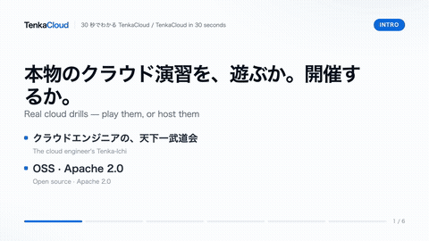
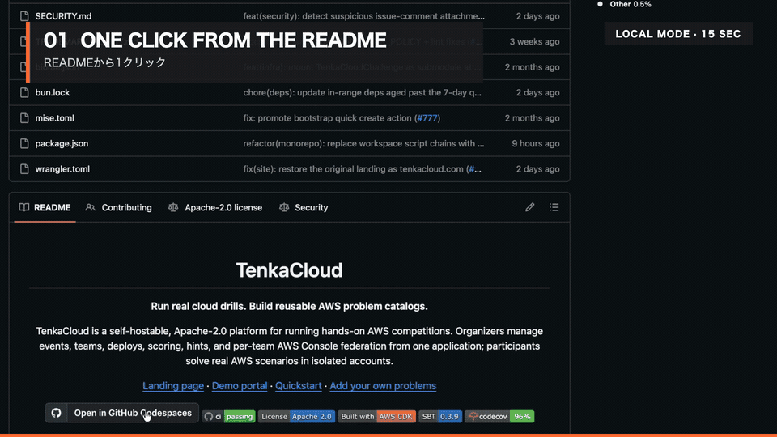

<!-- markdownlint-disable MD033 -->
<div align="center">

**English** | [日本語](./README.ja.md)

# TenkaCloud

**Run cloud competitions. Build reusable problem catalogs.**

TenkaCloud is a self-hostable, Apache-2.0 platform for hands-on cloud competitions. Organizers manage events, teams, problem environments, scoring and hints from one console. Participants solve local exercises or AWS scenarios with their own team keys.

<table>
<tr>
<td width="50%" align="center" valign="top">

**A. Try a local competition** <sub>(no AWS account needed)</sub>

[](https://codespaces.new/susumutomita/TenkaCloud)

</td>
<td width="50%" align="center" valign="top">

**B. Host on AWS** <sub>(AWS account, usage charges apply)</sub>

[**Deploy on AWS →**](#deploy-on-aws)

</td>
</tr>
</table>

<a href="./landing/videos/lp/tenkacloud-30s.mp4">
  
</a>
<br>
<sub>30-second product overview (silent, bilingual captions). Follow the current setup steps below. <a href="./landing/videos/lp/tenkacloud-30s.mp4">16:9 MP4</a> · <a href="./landing/videos/lp/tenkacloud-30s-vertical.mp4">9:16 MP4</a></sub>

[Landing page](https://tenkacloud.com) · [Manuals by role](https://tenkacloud.com/docs/manual/index.en.html) · [Demo portal](https://tenkacloud.com/portal-demo/?demo=1) · [Quickstart](#quickstart) · [Add your own problems](#add-your-own-problems)

[](https://github.com/susumutomita/TenkaCloud/actions/workflows/ci.yml)
[](https://codecov.io/gh/susumutomita/TenkaCloud)
[](./LICENSE)

<a href="https://www.producthunt.com/products/tenkacloud?embed=true&amp;utm_source=badge-featured&amp;utm_medium=badge&amp;utm_campaign=badge-tenkacloud" target="_blank" rel="noopener noreferrer"></a>

</div>

> TenkaCloud is an independent open-source project and is not affiliated with, endorsed by, or sponsored by Amazon Web Services, Inc. AWS and related marks are trademarks of Amazon.com, Inc. or its affiliates.

---

## Quickstart

Invited to an event? Use the **Participant Portal URL and team key from your organizer**. You do not need to install or deploy TenkaCloud.

### Try it locally (no AWS)

Install Git, Make and **Bun 1.3.11** on macOS, Linux or WSL2. Docker Engine with Compose v2 is needed for Docker exercises; the built-in Cryptography Battle needs neither Docker nor AWS. [mise.toml](./mise.toml) pins the development tools.

```bash
git clone https://github.com/susumutomita/TenkaCloud.git
cd TenkaCloud
make install
make catalog-download catalog-prepare
make local
```

1. Open the printed organizer URL and sign in with the new **organizer key** shown once in your terminal on each interactive `make local` start. No username or password is needed.
2. Create an event, add teams and select problems. Prepare their environments, then start the event.
3. Give each team its own participant URL and key. For Docker exercises, participants choose **Start / resume** when ready.
4. Solve a problem, submit the answer it requests and check the score.

**Rotate the organizer key while running?** Run `make local-reset` in another interactive terminal, using the same data directory. Each interactive `make local` start also creates a new key. Both revoke old organizer keys and sessions while keeping events, scores, participant keys and problem data. Noninteractive and public/container starts retain existing keys and never print them to logs. `make local-clear` retains the organizer key; it deletes event history.

**Clear local competition data:** `make local-clear` asks for confirmation before removing competition history and owned Docker exercise data. It preserves organizer access and host settings. Stop the host first; this differs from `make down` and organizer-key rotation.

**Finished for now?** Run `make down` from another terminal. It stops this controller and its owned Docker environments while retaining the database, keys, container writable layers and volumes. Start again with `make local`; participants resume on-demand exercises from their portal. Stop does not retain process memory or reset the event clock. Use the event's **Teardown** action to remove problem environments.

[Organizer manual](./apps/developer-portal/src/app/developers/docs/manual/organizer/page.mdx)

### Open a development environment in Codespaces

<div align="center">
  <a href="./docs/assets/codespaces-local-mode/codespaces-local-mode-readme-1280x720.mp4">
    
  </a>
  <br>
  <sub>15-second Codespaces introduction. The current setup starts the organizer console and participant portal described below.</sub>
</div>

[](https://codespaces.new/susumutomita/TenkaCloud)

Create a codespace, wait for dependency setup, then run `make local` in its terminal. The configured organizer and participant ports are 5174 and 5175. The recording shows an earlier local experience; forwarded-origin and exercise routing for the current competition host still need verification. Use the local setup above for a reviewed event.

### Deploy on AWS

Cloud hosting uses Lambda and Cognito, selectable Turso or DynamoDB, generic CloudFormation deployment, flag/multi-flag and scheduled scoring, participant Console/CLI access, and native coordination including Cryptography Battle. Docker/Compose exercises run locally. This checkout is an **integration candidate**: complete AWS event rehearsals and synchronized Battle performance remain under verification. Set `CDK_PARAM_CONTROL_DATA_BACKEND=turso` or `dynamodb` in the environment file; Turso also requires its database URL and an existing SSM token parameter. See [database configuration](./infrastructure/README.md#database-selection).

New installations use `tenkacloud-cloud` stack names; existing `tenkacloud-lite` stacks keep their names. The CLI discovers existing Lite/cloud installations and requires `TENKACLOUD_STACK_LAYOUT=lite` or `cloud` if both exist. Published cloud-v1 data/resources are not migrated automatically. Both databases admit 99 teams; SQL coordination retains its 4 MiB limit. All eight current templates fit within the 51,200-byte `TemplateBody` limit; live AWS rehearsal remains separate. See [existing stack names and limits](./infrastructure/README.md#existing-installations-and-resource-identity).

Prepare your AWS CLI profile, account, region and organizer email. `make env-init` prompts for these public settings and creates the selected `infrastructure/environments/<ENV>/.env` with owner-only permissions. Existing files are preserved; edit them when changing their settings.

```bash
aws sts get-caller-identity
make env-init ENV=development
make deploy ENV=development
```

For Turso, run `make turso-live ENV=development` after `env-init`; the restored wizard handles CLI/login, database and SSM token setup, then confirms deployment. Use `make turso-live-guide` for offline instructions and `make turso-token-rotate ENV=development` to renew the token without printing it. See [first-run setup and rotation](./infrastructure/README.md#first-run-setup-and-turso-credential-rotation).

`make deploy` validates and reuses the standard `CDKToolkit`, or creates it with the pinned official CDK bootstrap when missing. It then deploys with `--require-approval never`, including in CI; new and already-restored installations need no extra approval flag. Original unpinned Lite upgrades require the no-active-events confirmation below. The command displays the target, permissions and cost notice. Review [bootstrap and caller permissions](./infrastructure/BOOTSTRAP-IAM.md): the standard CloudFormation execution role defaults to `AdministratorAccess`. Application runtime roles do not receive that policy. Deployment uploads a fresh private source ZIP key and exact S3 version for CodeBuild; its source bucket remains after platform destroy and incurs storage until separately reviewed cleanup. Saved events/deployments retain their catalog snapshot across later updates; see [catalog continuity and legacy recovery](./infrastructure/README.md#update-the-problem-catalog).

AWS resource exercises require a verified competitor account. For your own self-test, the event creation flow can explicitly acknowledge the risk of using the hosting account before creating the event or issuing keys. Already created events can confirm the same risk from Schedule → Deploy now without recreation. Problem and participant roles may reach hosting configuration and data; this is not isolation, even across regions. Use a separate competitor account for events with third-party participants. Multiple teams may use different regions in one competitor account, with shared global IAM and problem-specific policy review. Native Cryptography Battle needs no competitor account when score stealing is disabled; enabling it retains the AWS variant.

Original unpinned Lite installations require a one-time confirmation that no active competitions remain, after resource/schema checks and before bootstrap, source upload or deployment. Keep active competitions on their installed version until completion. After verifying that condition, confirm interactively or use `CLOUD_ARGS="--confirm-no-active-events"` for a noninteractive upgrade; generic `--yes` cannot bypass this check. A legacy catalog key alone does not prove a safe upgrade, and historical data is not migrated automatically. New and already-restored installations keep ordinary automatic `make deploy` behavior.

For an AWS-console deployment, review the [cloud pipeline](./infrastructure/README.md#cloud-deployment-pipeline), its source settings and its privileged CodeBuild role. Creating the launcher and starting a build are separate actions; only trusted deployment administrators should start builds.

Before inviting participants, create a test event and team, open a problem, submit an answer and verify its score.

**After the event:** `make destroy ENV=development` confirms the account, region and owned resources, then removes platform hosting and its default-owned data. Exercise cleanup is separate: use the event Teardown action before removing the platform. DynamoDB tables are deleted by default; only an explicit retain setting keeps them. Ordinary destroy leaves external Turso rows; `make destroy-all` explicitly resets those rows and purges stack-owned retained data. Retained storage and AWS resources can incur charges. See [setup and teardown](./infrastructure/README.md#current-checkouts-setup-and-teardown-boundary) for the current lifecycle and recovery steps.

After confirmation, destroy empties only verified CloudFormation-owned S3 buckets with a deployed `Delete` policy, including object versions and delete markers, before removing the stacks. Buckets with a `Retain` policy and their contents remain on ordinary destroy. Explicit `destroy-all` can empty retained contents; `Retain` bucket containers remain. The caller needs the [direct S3 cleanup permissions](./infrastructure/BOOTSTRAP-IAM.md#direct-deployment-and-cleanup-permissions), separately from CloudFormation's execution permissions.

For Turso competition-data cleanup, including after AWS stacks are gone, use `make turso-clear ENV=development`. It uses the selected environment's `CDK_PARAM_TURSO_DATABASE_URL`. A nonblank inherited `TURSO_AUTH_TOKEN` selects direct access; otherwise it retrieves the existing token from the configured SSM SecureString. Direct access requires no AWS account, region or profile. Supply a direct token through your process environment, never `.env`, command arguments or logs; file tokens are ignored. Explicit `--credentials direct` or `--credentials ssm` overrides the selection, and a failed credential is never retried with another source. Preview the target and competition-data tables with `CLOUD_ARGS="--plan"`; deletion asks for confirmation or requires `CLOUD_ARGS="--yes"` unattended. Account and SAML settings, feature flags, admin audit logs, schema, migrations and unrelated tables remain. Stop writers and complete exercise Teardown first; clear does not remove AWS or Docker resources. SSM access requires matching `ACCOUNT_ID` and `AWS_REGION`, the configured `CDK_PARAM_TURSO_AUTH_TOKEN_PARAMETER_NAME`, and `ssm:GetParameter` on the exact parameter ARN, plus `kms:Decrypt` for a customer-managed KMS key. `make turso-reset` deletes all known control-data rows, including account, IdP, connection, feature-flag and admin-audit data where present; schema, migration markers, unrelated tables and configuration files remain; the SSM parameter and Turso database itself are also preserved. Reset uses SSM and valid AWS credentials for an STS account check; STS `GetCallerIdentity` needs no explicit IAM permission grant. See [standalone Turso cleanup](./infrastructure/README.md#standalone-turso-data-reset).

To inspect commands without AWS access, use `make deploy CLOUD_ARGS="--help"` or `make destroy CLOUD_ARGS="--help"`.

## Running costs

| Hosting | What to budget for |
| --- | --- |
| Local | Your computer, disk and Docker capacity; native Cryptography Battle runs in Bun and SQLite |
| AWS | Hosting services, your chosen database, selected problem resources and retained data; the console pipeline also uses CodeBuild |

No hosting option promises a zero bill.

## Add your own problems

Problem content lives in [TenkaCloudChallenge](https://github.com/susumutomita/TenkaCloudChallenge). Use its authoring and validation workflow to contribute to the competition catalog. You do not need to fork the platform to author a problem.

Select and download problem repositories with `make catalog-download CATALOG_SOURCES=my-catalogs.json`, then validate and rebuild. Existing event snapshots are retained. No running host is updated by downloading.

Each source's `ref` accepts a tag, a branch or a full commit. Downloading resolves it once and records the commit and content digest; startup and builds never read the remote ref. The default `catalog-sources.json` selects a TenkaCloudChallenge release tag. To move it, change the tag, run `make catalog-download catalog-prepare`, copy the resolved `sources` from `.tenkacloud/catalog-store/selected.json` into `catalog-lock.json`, then run `bun run scripts/release/host-candidate.ts --sync-catalog`. CI runs `make catalog-verify-lock` after downloading and fails when a moved tag no longer matches `catalog-lock.json`.

New stable TenkaCloudChallenge releases arrive as automated catalog PRs, checked daily or through the Catalog release bump workflow with an optional tag. Each PR retains the previous revision and, while the host candidate has no built image, syncs its catalog pin in `release/host-candidate.json`. Review release notes for renamed problem IDs and required core changes before merging. Enable the one-time repository setting under Settings → Actions → General → Workflow permissions → "Allow GitHub Actions to create and approve pull requests". If it is disabled, the workflow fails and leaves the pushed branch for manual PR creation. The workflow dispatches `ci.yml` on the PR branch because `GITHUB_TOKEN` PRs do not start CI automatically.

The default selection also declares the previous fixed catalog in `retained`, including its commit, content digest and problems root. `catalog-download` restores and verifies it even in an empty store so host and cloud portal builds include saved events' browser modules. Retained problems are not offered in new events. Keep these pins in both `catalog-sources.json` and `catalog-lock.json` while those editions need support; a failed restore stops acquisition before changing the selection.

For reusable or private content, the public SDK and offline Problem Pack tools create, validate and store immutable revisions:

```bash
bun run pack init ./my-pack
bun run pack validate ./my-pack
bun run pack install ./my-pack
bun run pack list
```

Cloud reads activated AWS/CloudFormation packs on the next deployment. Local reads its `problems/` tree and does not consume the Pack store. [Pack tutorial](./apps/developer-portal/src/app/developers/docs/tutorials/first-pack/page.mdx) · [External Git pack workflow](./scripts/problem-pack/README-external-git-pack.md)

## Documentation

| You want to… | Read |
| --- | --- |
| Run an event | [Planning and operations](./apps/developer-portal/src/app/developers/docs/operate/run-an-event/page.mdx) |
| Deploy or remove AWS hosting | [Deployment guide](./DEPLOYMENT_GUIDE.md) |
| Prepare competitor accounts | [Account onboarding](./infrastructure/templates/README.md) |
| Ask an LLM to help | [LLM entry point](./landing/llms.txt) · [Task guide and code map](./landing/llms-full.txt) |
| Understand the architecture | [Architecture guide](./docs/architecture/README.md) · [Editable AWS system diagram](./docs/architecture/diagrams/system-architecture.drawio) |
| Ask for help | [GitHub Discussions](https://github.com/susumutomita/TenkaCloud/discussions) (public) |

## Development

Use [CONTRIBUTING.md](./CONTRIBUTING.md), [AGENTS.md](./AGENTS.md) and the [developer manual](./apps/developer-portal/src/app/developers/docs/manual/developer/page.mdx).

```bash
make install
make test
make lint
make before-commit
```

Run focused checks while developing and `make before-commit` before committing. It runs lint and the tests for the files you changed; CI runs every test.

## Vision

Practice on your own, then compete as a team. Reusable problems let communities share exercises and organizers build their own events.

## Books

[Build Your Own Cloud Competition](https://leanpub.com/build-your-own-cloud-competition) · [自分で作るクラウド競技](https://zenn.dev/bull/books/cloud-competition).
The books explain design decisions; the repository is the source of truth for how it currently works.

## License

[Apache License 2.0](./LICENSE). TenkaCloud is an independent open-source project and is not affiliated with AWS.
