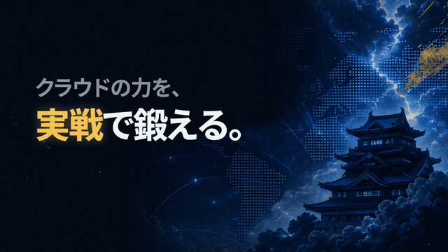
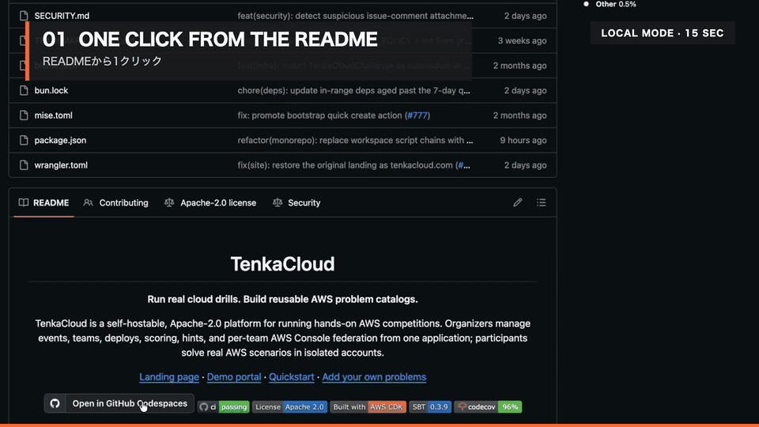

<!-- markdownlint-disable MD033 -->
<div align="center">

**English** | [日本語](./README.ja.md)

# TenkaCloud

**Run cloud competitions. Build reusable problem catalogs.**

TenkaCloud is a self-hostable, Apache-2.0 platform for hands-on cloud competitions. Organizers manage events, teams, problem environments, scoring and hints from one console. Participants solve local exercises or AWS scenarios with their own team keys.

Participants can also use a local AI agent through [stdio or cloud Streamable HTTP MCP](./docs/mcp.md): discover problems, start prepared Docker exercises, submit answers, and check scores.

<table>
<tr>
<td width="50%" align="center" valign="top">

**A. Try a local competition** <sub>(no AWS account needed)</sub>

[](https://codespaces.new/susumutomita/TenkaCloud)

</td>
<td width="50%" align="center" valign="top">

**B. Host on AWS** <sub>(AWS account, usage charges apply)</sub>

[**Deploy on AWS →**](#deploy-on-aws)

</td>
</tr>
</table>

<a href="./landing/videos/lp/tenkacloud-60s.mp4">
  
</a>
<br>
<sub>64-second introduction (music, no narration; Japanese headlines with English subtitles). Every screen is a real capture from a local run; the Simulator scenes show Hello World, the one problem that integration is validated for. <a href="./docs/assets/lp-60s/README.md">How it was recorded</a>. Follow the current setup steps below. Earlier 30-second silent overview: <a href="./landing/videos/lp/tenkacloud-30s.mp4">16:9 MP4</a> · <a href="./landing/videos/lp/tenkacloud-30s-vertical.mp4">9:16 MP4</a></sub>

[Landing page](https://tenkacloud.com) · [Manuals by role](https://tenkacloud.com/docs/manual/index.en.html) · [Demo portal](https://tenkacloud.com/portal-demo/?demo=1) · [Quickstart](#quickstart) · [Add your own problems](#add-your-own-problems)

[](https://github.com/susumutomita/TenkaCloud/actions/workflows/ci.yml)
[](https://codecov.io/gh/susumutomita/TenkaCloud)
[](./LICENSE)

<a href="https://www.producthunt.com/products/tenkacloud?embed=true&amp;utm_source=badge-featured&amp;utm_medium=badge&amp;utm_campaign=badge-tenkacloud" target="_blank" rel="noopener noreferrer"></a>

</div>

> TenkaCloud is an independent open-source project and is not affiliated with, endorsed by, or sponsored by Amazon Web Services, Inc. AWS and related marks are trademarks of Amazon.com, Inc. or its affiliates.

---

## Quickstart

Invited to an event? Use the **Participant Portal URL and team key from your organizer**. You do not need to install or deploy TenkaCloud.

### Try it locally (no AWS)

Install Git, Make and **Bun 1.4.4** on macOS, Linux or WSL2. Docker Engine with Compose v2 is needed for Docker exercises; the built-in Cryptography Battle needs neither Docker nor AWS. [mise.toml](./mise.toml) pins the development tools.

```bash
git clone https://github.com/susumutomita/TenkaCloud.git
cd TenkaCloud
make install
make local
```

With Claude Code installed, run `claude` in the cloned repository and type `/tenkacloud-setup`. It checks your tools and ports, asks how you will host, runs `make install` and builds the `make local` command for you to run in your own terminal.

1. Open the printed organizer URL and sign in with the new **organizer key** shown once in your terminal on each interactive `make local` start. No username or password is needed.
2. Create an event, add teams and select problems. Prepare their environments, then start the event.
3. Give each team its own participant URL and key. For Docker exercises, participants choose **Start / resume** when ready.
4. Solve a problem, submit the answer it requests and check the score.

### Local AWS simulator (explicit opt-in)

Same-machine loopback hosting starts a managed native Simulator by default. On first use it selects the newest compatible stable release from the newest 100 official GitHub Releases, verifies its `BUILDINFO.json` and binary against that release's `SHA256SUMS`, and writes an owner-only local `simulator-binaries/release-lock.json` under the host data directory. The lock records the version, launcher/control-API protocol and checksums for Linux/macOS amd64/arm64. No Simulator version, source commit or per-platform checksum needs to be updated in the TenkaCloud repository for later releases.

Subsequent starts use that local lock and reverify cached bytes without checking for newer releases. A missing cached binary is downloaded only from the locked version and verified against its recorded checksum. With a valid cache, startup works offline. First use, explicit updates and missing cache downloads require connectivity; errors never silently use corrupt or unverified bytes.

Run `make local LOCAL_ARGS="--update-simulator"` to explicitly select, verify and lock a newer compatible stable release before starting it. Discovery/download/verification failures retain the existing lock and stop startup. Same-version asset changes and automatic downgrades are rejected. The host protocol describes the launcher CLI and local-token control API, not SQLite downgrade compatibility. Once an update is committed, a failed startup does not automatically roll back the binary or persistent state. Updates should be made between sessions with appropriate state backups.

Checksums from the same publisher detect corruption and release inconsistencies; they are not independent protection against a compromised publisher. Downloads remain limited to official GitHub hosts, bounded in size and privately cached. Concurrent release operations fail explicitly; an interrupted operation can leave `simulator-binaries/.release-operation`, which should be removed only after confirming the previous process has stopped. The binary is never built from Go source, and there is no real-AWS fallback.

A compatible official release must actually be published before first use. Until then startup reports that none is available; it does not invent a version or checksum. Use `make local LOCAL_ARGS="--simulator-binary /absolute/path/to/tenkacloud-simulator"` for an existing compatible executable, or `make local LOCAL_ARGS="--no-simulator"` for Docker/browser exercises without Simulator. LAN, public, proxy and VPN hosting never automatically start Simulator. The managed child uses a private persistent database and token, an automatically assigned loopback port, and stops after host operations drain. Restart retains state and token; an unexpected Simulator exit stops the host.

To connect an already running local TenkaCloud Simulator instead, use its existing private operator token file. Relative token-file paths are resolved from the host working directory, not the Simulator checkout. Missing or unsafe files fail before catalog downloads or builds; no token is recreated. Prefer an absolute path:

```sh
make local LOCAL_ARGS="--simulator-endpoint http://127.0.0.1:4566 --simulator-token-file /absolute/path/to/simulator-token --simulator-region ap-northeast-1 --simulator-bootstrap"
```

All three simulator options are required. The endpoint must be a literal loopback HTTP address with a port. The token file must be a regular, owner-only file owned by the host user (for example mode `0600`), not a symlink. The host reads it privately; never paste its contents into a command or logs. AWS SDK calls use the explicit local endpoint and local credentials, with no real-AWS credential or endpoint fallback. For the host process, unset `HTTP_PROXY`, `HTTPS_PROXY`, `ALL_PROXY` and their lowercase variants: simulator mode rejects ambient proxies before startup and before every SDK request, even if `NO_PROXY` is set. This does not modify proxy settings for other processes. Ambient `AWS_REGION` / `AWS_ENDPOINT_URL` alone do not enable this mode, and the old `--aws-region` option remains rejected.

Acquire the original problem catalog normally. The opt-in `--simulator-bootstrap` creates a simulator-only, least-privilege deployment role using the host-generated ExternalId and operator trust. It never overwrites a conflicting stack/role; an owned matching bootstrap is verified and reused on restart. The ordinary real-AWS bootstrap template is unchanged and is not used because its AdministratorAccess is unnecessary here. In the organizer account setup, register local account `000000000000` and role `TenkaCloud-SimulatorDeploy-Role`, then verify it. Simulator setup does not show real-AWS launch/share links or reveal the ExternalId. Event creation, deployment, team login, grading and teardown use the normal host workflow. The participant credential panel includes the simulator endpoint and exports it with the temporary keys. A native Simulator advertising participant console handoff v1 also enables **Open Simulator Console** in SSO Credentials. This opens the deployed team’s own SSM parameter with the existing viewer role through a short-lived, one-use sign-in code; the operator token is never sent to the participant. The original Hello World viewer is read-only. Older Simulator versions retain CLI-only access and show update guidance. Update both programs between sessions before expecting the Console button. This is the local Simulator console, not AWS console federation; real-AWS console output links remain unavailable. Both programs and participant CLI commands must run on the same machine: a loopback URL copied to another laptop cannot reach this simulator. Public, LAN, VPN and proxy exposure are rejected until an authenticated remote simulator connection is supported. Running both programs in a cloud environment does not imply remote-participant or multi-team simulator tenancy support. The copied setup adds only the simulator loopback host to both `NO_PROXY` and `no_proxy`, retaining other proxy settings and exclusions. The CLI wrapper reestablishes this bypass if exclusions change; SDK programs must retain the exported bypass. The copied simulator setup defines a local-only `aws` shell function: it requires the configured endpoint to remain unchanged, rejects endpoint overrides and calls the installed AWS CLI with explicit `--endpoint-url`. Keep that wrapper active when using the original problem commands; bypassing it with `command aws`, a new shell or another program is not covered. Use the tested CLI profile: official AWS CLI v1 **1.46.3** (pinned). Other CLI versions have not been rehearsed here. For environment-configured SDK use, the tested profiles are boto3 **1.43.62** with botocore **1.43.62**, or AWS SDK for JavaScript v3 **3.1161.0**. Older SDKs may ignore `AWS_ENDPOINT_URL`; do not use them with the copied setup. Prefer an explicit validated endpoint when constructing SDK clients. These are tested simulator profiles, not claims about when AWS introduced endpoint configuration.

The current limited bootstrap is validated for Hello World only. Simulator mode exposes only Hello World in the AWS problem catalog; other AWS problems, including Hello World Battle, are unavailable. Saved unsupported AWS jobs are rejected before requests for deployment, recovery, credentials, logs or teardown, and their retained state is preserved. AWS command disruptions are also unavailable: retained operations stay unresolved without STS or SSM requests. Use their original supported hosting mode for cleanup. The ordinary real-AWS catalog and execution are unchanged. A successful Hello World rehearsal is not proof that every AWS problem works. Deployment logs are read from the team's stack through `DescribeStackEvents` and omit resource properties and secrets.

An opt-in, checked-in full `make local` rehearsal is available as `bun run test:simulator-hello`. See [prerequisites and the local-only command](scripts/local-host/integration/README.md). It uses an explicitly supplied Simulator binary and AWS CLI, preserves existing state, and does not install dependencies or download problems.

**Rotate the organizer key while running?** Run `make local-reset` in another interactive terminal, using the same data directory. Each interactive `make local` start also creates a new key. Both revoke old organizer keys and sessions while keeping events, scores, participant keys and problem data. Noninteractive and public/container starts retain existing keys and never print them to logs. `make local-clear` retains the organizer key; it deletes event history.

**Clear local competition data:** `make local-clear` asks for confirmation before removing competition history and owned Docker exercise data. It preserves organizer access and host settings. Stop the host first; this differs from `make down` and organizer-key rotation.

**Finished for now?** Run `make down` from another terminal. It stops this controller and its owned Docker environments while retaining the database, keys, container writable layers and volumes. Start again with `make local`; participants resume on-demand exercises from their portal. Stop does not retain process memory or reset the event clock. Use the event's **Teardown** action to remove problem environments.

[Organizer manual](./apps/developer-portal/src/app/developers/docs/manual/organizer/page.mdx)

### Join from another device over Tailscale

First verify startup, joining and scoring on one PC. For remote participants, start with the hosting device's currently assigned Tailscale IPv4. Follow the [first-connection guide](https://tenkacloud.com/docs/getting-started/index.en.html#tailscale-first-connection) for app installation, account selection, dedicated-host sharing and effective permissions. Do not share a company tailnet or device without approval.

Use Tailscale 1.104.4 or newer on the event host and on participant devices. `tailscale version --daemon` shows the client and local `tailscaled`. This path does not enable Tailscale SSH or Tailscale Serve. Before the event, set `TS_SSH_DISABLE_FORWARDING=1` for the host's `tailscaled`, restart it, and replace any allow-all rule that still lets invited users reach ports other than TCP 5175 (and the Docker gateway range only when those exercises are used). The [client security note](https://tenkacloud.com/docs/getting-started/index.en.html#tailscale-client-security) has the grant example and the headscale limitation.

```bash
make local LOCAL_ARGS="--lan $(tailscale ip -4) --unsafe-lan"
```

Run in an interactive terminal; redirecting output to a log does not reveal the organizer key. The organizer uses `http://127.0.0.1:5174/` on the host. Give each participant the printed `http://<host-IPv4>:5175/` and only their team's key. A copied team invitation has the form `<participant-URL>/login#invite=<team-key>`. Treat the link as a secret; send it only to its intended recipient and keep it out of public logs and screenshots. Do not forward or proxy 5174 to participants.

`--lan` selects an HTTP listener; it does not configure a VPN or firewall. Check permission for participant TCP 5175 and, only when using Docker exercises, the configured gateway ports (default TCP 5200–5239). Only active gateways listen. Start with a native problem such as Crypto Battle and check login, actions and scores. Remote Docker requires supported native Linux with explicit isolation; Mac / Docker Desktop is unsupported. Start/resume/recovery without that mode is refused. For a group of fully trusted participants only, add `--unsafe-docker-lan` (`make local LOCAL_ARGS="--lan $(tailscale ip -4) --unsafe-lan --unsafe-docker-lan"`) to run Docker exercises with no network isolation between teams; they can then reach other teams' exercises, the host and the LAN. It cannot be combined with `--competition-network`, `--vpn-peers` or public origins, and events prepared with isolation stay refused, so create a new event. If Docker itself is unavailable, startup and the organizer UI explain why and Docker problems cannot enter new events. After making Docker available, coordinate a maintenance time before restarting the host.

Use the printed IP URL rather than a MagicDNS URL with this setup. Changing the Tailscale account/IP does not update a running host's bind address. Coordinate stopping and starting it with the correct IP. Connectivity alone does not prove isolation of participant PCs/home networks or complete live-event playability.

### Open a development environment in Codespaces

<div align="center">
  <a href="./docs/assets/codespaces-local-mode/codespaces-local-mode-readme-1280x720.mp4">
    
  </a>
  <br>
  <sub>15-second Codespaces introduction. The current setup starts the organizer console and participant portal described below.</sub>
</div>

[](https://codespaces.new/susumutomita/TenkaCloud)

New Codespaces run [.devcontainer/post-create.sh](./.devcontainer/post-create.sh): it installs the exact Bun version from `mise.toml` with the [official installer](https://bun.com/docs/installation), verifies it, then runs `make install` with lifecycle scripts disabled and explicit Husky setup. The configured universal image uses `/home/codespace/.bun`; `remoteEnv` adds its binary directory to new terminals. Problems are acquired by `make local` from the selected sources, not a Git submodule.

An existing codespace does not rerun initialization just because its checkout changes. After adopting this revision, you can explicitly prepare dependencies from the repository root as below. Coordinate maintenance first if a host is running; this does not rebuild the codespace or start a host.

```bash
bash .devcontainer/post-create.sh
export PATH="${BUN_INSTALL:-$HOME/.bun}/bin:$PATH"
bun --version # must match mise.toml
```

The configured ports remain 5174 and 5175. Inside Codespaces, `make local` validates the Codespaces name/domain and selects exact HTTPS forwarding origins using those ports. Explicit public origins take precedence. This uses native public mode: both listeners bind the container interfaces, Docker/Compose problems are excluded, and no key is logged at startup. Keep organizer port 5174 Private; obtain a key through `make local-reset` in a private interactive terminal with the same data directory (this revokes old organizer sessions). Port visibility and proxy trust are never changed automatically. See the [Codespaces guide](https://tenkacloud.com/docs/getting-started/index.en.html#codespaces-native). Local origin/authentication regressions pass; live Codespaces proxy/browser behavior and remote events remain unverified. The recording shows an earlier experience.

### Deploy on AWS

Cloud hosting uses Lambda and Cognito, selectable Turso or DynamoDB, generic CloudFormation deployment, flag/multi-flag and scheduled scoring, participant Console/CLI access, and native coordination including Cryptography Battle. Docker/Compose exercises run locally. This checkout is an **integration candidate**: complete AWS event rehearsals and synchronized Battle performance remain under verification. Set `CDK_PARAM_CONTROL_DATA_BACKEND=turso` or `dynamodb` in the environment file; Turso also requires its database URL and an existing SSM token parameter. See [database configuration](./infrastructure/README.md#database-selection).

New installations use `tenkacloud-cloud` stack names; existing `tenkacloud-lite` stacks keep their names. The CLI discovers existing Lite/cloud installations and requires `TENKACLOUD_STACK_LAYOUT=lite` or `cloud` if both exist. Published cloud-v1 data/resources are not migrated automatically. Both databases admit 99 teams; SQL coordination retains its 4 MiB limit. All eight current templates fit within the 51,200-byte `TemplateBody` limit; live AWS rehearsal remains separate. See [existing stack names and limits](./infrastructure/README.md#existing-installations-and-resource-identity).

Prepare your AWS CLI profile, account, region and organizer email. `make env-init` prompts for these public settings and creates the selected `infrastructure/environments/<ENV>/.env` with owner-only permissions. Existing files are preserved; edit them when changing their settings.

```bash
aws sts get-caller-identity
make env-init ENV=development
make deploy ENV=development
```

For Turso, run `make turso-live ENV=development` after `env-init`; the restored wizard handles CLI/login, database and SSM token setup, then confirms deployment. Use `make turso-live-guide` for offline instructions and `make turso-token-rotate ENV=development` to renew the token without printing it. See [first-run setup and rotation](./infrastructure/README.md#first-run-setup-and-turso-credential-rotation).

`make deploy` validates and reuses the standard `CDKToolkit`, or creates it with the pinned official CDK bootstrap when missing. It then deploys with `--require-approval never`, including in CI; new and already-restored installations need no extra approval flag. Original unpinned Lite upgrades require the no-active-events confirmation below. The command displays the target, permissions and cost notice. Review [bootstrap and caller permissions](./infrastructure/BOOTSTRAP-IAM.md): the standard CloudFormation execution role defaults to `AdministratorAccess`. Application runtime roles do not receive that policy. Deployment uploads a fresh private source ZIP key and exact S3 version for CodeBuild; its source bucket remains after platform destroy and incurs storage until separately reviewed cleanup. Saved events/deployments retain their catalog snapshot across later updates; see [catalog continuity and legacy recovery](./infrastructure/README.md#update-the-problem-catalog).

AWS resource exercises require a verified competitor account. For your own self-test, the event creation flow can explicitly acknowledge the risk of using the hosting account before creating the event or issuing keys. Already created events can confirm the same risk from Schedule → Deploy now without recreation. Problem and participant roles may reach hosting configuration and data; this is not isolation, even across regions. Use a separate competitor account for events with third-party participants. Multiple teams may use different regions in one competitor account, with shared global IAM and problem-specific policy review. Native Cryptography Battle needs no competitor account when score stealing is disabled; enabling it retains the AWS variant.

Original unpinned Lite installations require a one-time confirmation that no active competitions remain, after resource/schema checks and before bootstrap, source upload or deployment. Keep active competitions on their installed version until completion. After verifying that condition, confirm interactively or use `CLOUD_ARGS="--confirm-no-active-events"` for a noninteractive upgrade; generic `--yes` cannot bypass this check. A legacy catalog key alone does not prove a safe upgrade, and historical data is not migrated automatically. New and already-restored installations keep ordinary automatic `make deploy` behavior.

For an AWS-console deployment, review the [cloud pipeline](./infrastructure/README.md#cloud-deployment-pipeline), its source settings and its privileged CodeBuild role. Creating the launcher and starting a build are separate actions; only trusted deployment administrators should start builds.

Before inviting participants, create a test event and team, open a problem, submit an answer and verify its score.

**After the event:** `make destroy ENV=development` confirms the account, region and owned resources, then removes platform hosting and its default-owned data. Exercise cleanup is separate: use the event Teardown action before removing the platform. DynamoDB tables are deleted by default; only an explicit retain setting keeps them. Ordinary destroy leaves external Turso rows; `make destroy-all` explicitly resets those rows and purges stack-owned retained data. Retained storage and AWS resources can incur charges. See [setup and teardown](./infrastructure/README.md#current-checkouts-setup-and-teardown-boundary) for the current lifecycle and recovery steps.

After confirmation, destroy empties only verified CloudFormation-owned S3 buckets with a deployed `Delete` policy, including object versions and delete markers, before removing the stacks. Buckets with a `Retain` policy and their contents remain on ordinary destroy. Explicit `destroy-all` can empty retained contents; `Retain` bucket containers remain. The caller needs the [direct S3 cleanup permissions](./infrastructure/BOOTSTRAP-IAM.md#direct-deployment-and-cleanup-permissions), separately from CloudFormation's execution permissions.

For Turso competition-data cleanup, including after AWS stacks are gone, use `make turso-clear ENV=development`. It uses the selected environment's `CDK_PARAM_TURSO_DATABASE_URL`. A nonblank inherited `TURSO_AUTH_TOKEN` selects direct access; otherwise it retrieves the existing token from the configured SSM SecureString. Direct access requires no AWS account, region or profile. Supply a direct token through your process environment, never `.env`, command arguments or logs; file tokens are ignored. Explicit `--credentials direct` or `--credentials ssm` overrides the selection, and a failed credential is never retried with another source. Preview the target and competition-data tables with `CLOUD_ARGS="--plan"`; deletion asks for confirmation or requires `CLOUD_ARGS="--yes"` unattended. Account and SAML settings, feature flags, admin audit logs, schema, migrations and unrelated tables remain. Stop writers and complete exercise Teardown first; clear does not remove AWS or Docker resources. SSM access requires matching `ACCOUNT_ID` and `AWS_REGION`, the configured `CDK_PARAM_TURSO_AUTH_TOKEN_PARAMETER_NAME`, and `ssm:GetParameter` on the exact parameter ARN, plus `kms:Decrypt` for a customer-managed KMS key. `make turso-reset` deletes all known control-data rows, including account, IdP, connection, feature-flag and admin-audit data where present; schema, migration markers, unrelated tables and configuration files remain; the SSM parameter and Turso database itself are also preserved. Reset uses SSM and valid AWS credentials for an STS account check; STS `GetCallerIdentity` needs no explicit IAM permission grant. See [standalone Turso cleanup](./infrastructure/README.md#standalone-turso-data-reset).

To inspect commands without AWS access, use `make deploy CLOUD_ARGS="--help"` or `make destroy CLOUD_ARGS="--help"`.

## Running costs

| Hosting | What to budget for |
| --- | --- |
| Local | Your computer, disk and Docker capacity; native Cryptography Battle runs in Bun and SQLite |
| AWS | Hosting services, your chosen database, selected problem resources and retained data; the console pipeline also uses CodeBuild |

No hosting option promises a zero bill.

## Add your own problems

Problem content lives in [TenkaCloudChallenge](https://github.com/susumutomita/TenkaCloudChallenge). Use its authoring and validation workflow to contribute to the competition catalog. You do not need to fork the platform to author a problem.

Configure the repository URL and branch in `catalog-sources.json` (`url` and `ref`). The default is TenkaCloudChallenge's `main` branch. `make local` and `make deploy` acquire that branch before building. For another source configuration, use `CATALOG_SOURCES=my-catalogs.json` with either command.

Each launch or deployment resolves the configured branch again. Acquisition failures stop the command and report the cause; they do not continue with an older cached selection. `--no-build` also acquires the branch and refuses to start if its interfaces need rebuilding. A running host is unchanged until restarted or redeployed. Manual build preparation remains available through `make catalog-download catalog-prepare`.

Resolved commits and content digests are recorded in `.tenkacloud/catalog-store/selected.json`. Acquisition fetches only the configured sources; it does not fetch historical catalogs. Existing local snapshots remain available for saved events' definitions, progress and browser modules, and are not offered as new-event problems. Preserve those assets when moving an installation; missing history is not automatically downloaded.

CI does not download a catalog; it tests against the frozen inputs in `scripts/problem-pack/test/fixtures/ci-catalog`. Normal startup uses `catalog-sources.json` directly. There is no separate committed catalog lock, fixed-edition acquisition command or catalog update PR workflow.

For reusable or private content, the public SDK and offline Problem Pack tools create, validate and store immutable revisions:

```bash
bun run pack init ./my-pack
bun run pack validate ./my-pack
bun run pack install ./my-pack
bun run pack list
```

Cloud reads activated AWS/CloudFormation packs on the next deployment. Local reads its `problems/` tree and does not consume the Pack store. [Pack tutorial](./apps/developer-portal/src/app/developers/docs/tutorials/first-pack/page.mdx) · [External Git pack workflow](./scripts/problem-pack/README-external-git-pack.md)

## Documentation

| You want to… | Read |
| --- | --- |
| Run an event | [Planning and operations](./apps/developer-portal/src/app/developers/docs/operate/run-an-event/page.mdx) |
| Deploy or remove AWS hosting | [Deployment guide](./DEPLOYMENT_GUIDE.md) |
| Prepare competitor accounts | [Account onboarding](./infrastructure/templates/README.md) |
| Ask an LLM to help | [LLM entry point](./landing/llms.txt) · [Task guide and code map](./landing/llms-full.txt) |
| Understand the architecture | [Architecture guide](./docs/architecture/README.md) · [Editable AWS system diagram](./docs/architecture/diagrams/system-architecture.drawio) |
| Ask for help | [GitHub Discussions](https://github.com/susumutomita/TenkaCloud/discussions) (public) |

## Development

Use [CONTRIBUTING.md](./CONTRIBUTING.md), [AGENTS.md](./AGENTS.md) and the [developer manual](./apps/developer-portal/src/app/developers/docs/manual/developer/page.mdx).

```bash
make install
make test
make lint
make before-commit
```

Run focused checks while developing and `make before-commit` before committing. It runs lint and the tests for the files you changed; CI runs every test.

## Vision

Practice on your own, then compete as a team. Reusable problems let communities share exercises and organizers build their own events.

## Books

[Build Your Own Cloud Competition](https://leanpub.com/build-your-own-cloud-competition) · [自分で作るクラウド競技](https://zenn.dev/bull/books/cloud-competition).
The books explain design decisions; the repository is the source of truth for how it currently works.

## License

[Apache License 2.0](./LICENSE). TenkaCloud is an independent open-source project and is not affiliated with AWS.
