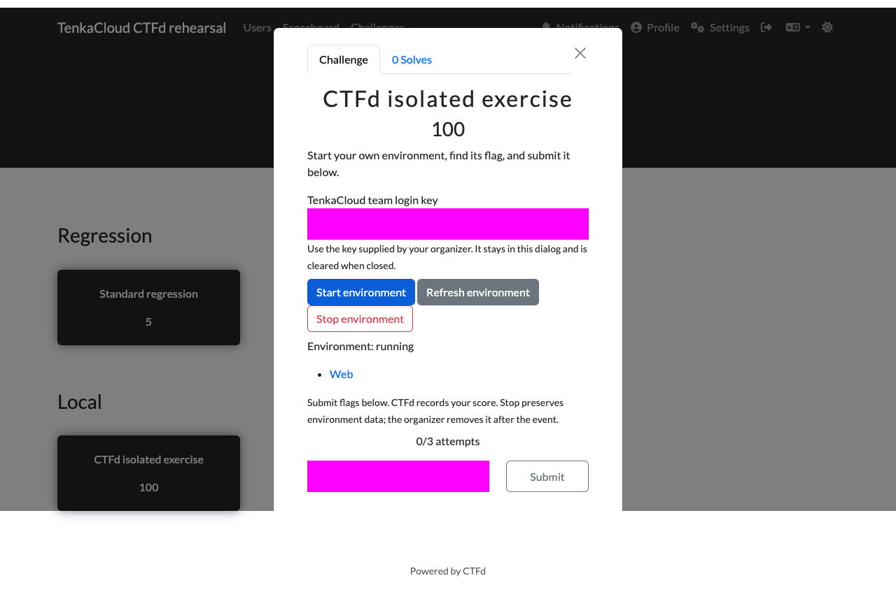
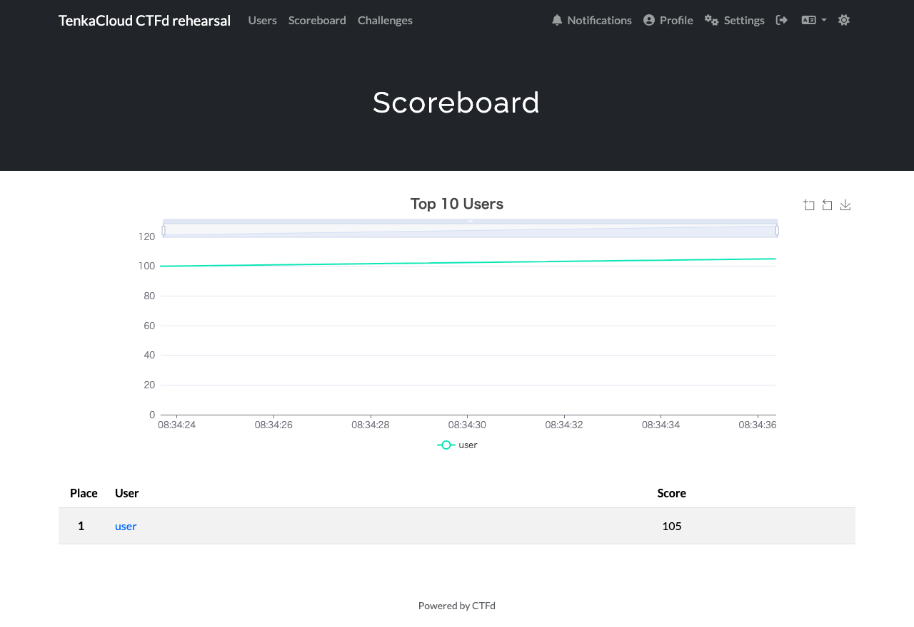

# CTFd 連携の検証記録

CTFd が参加者認証・問題表示・採点を担当し、TenkaCloud がチーム別 Docker
環境の起動・停止・回収を担当する。プラグインは CTFd 内で動き、追加サーバー・
DB・保存する認証情報を設けない。既存キーと大会 ID で接続先を限定する。
無得点の evaluate API は container verifier の boolean を返し、TenkaCloud
の score、snapshot、score events、progress を保存しない。

## 確認済み

実 CTFd 3.8.2、実 HTTP・SQLite、実 Docker と Chrome を使用した。
core は catalog pin `cd14b1ffcb88e73a7fc83c269c4441775acdde61` の
`sqli-demo`、core-deprecated は TenkaCloud 内の専用 fixture を使用した。
どちらも隔離した 2 チーム、大会、CTFd の一時 DB で実行した。

| 操作・境界 | 結果 |
| --- | --- |
| CTFd の問題表示、チームキー入力 | 成功 |
| 停止中の flag 評価 | 拒否。保存・画面の試行数を増やさない |
| 参加者による環境起動と readiness の反映 | 成功 |
| 問題 Web 画面から生成 flag を取得 | core の sqli-demo で成功 |
| 誤答・正答 | 誤答を拒否し、正答を CTFd に 100 点として保存 |
| 同じページで通常の CTFd 問題を採点 | 5 点を加算。submit 復元の回帰を確認 |
| CTFd scoreboard | 合計 105 点 |
| TenkaCloud の採点イベント | 両チームとも 0 件 |
| 環境停止 | 成功。Web link を除去し gateway を閉じる |
| ダイアログ終了 | キーを消去し、poll と submit override を解除 |
| 2 チームの環境 | 別々の owned job とアクセス URL |
| 開催者による大会終了・環境回収 | 全 job が DELETED |
| ブラウザの未捕捉例外 | 両テーマとも 0 件 |

結果は [core](evidence/core-result.json) と
[core-deprecated](evidence/deprecated-result.json) に保存した。
画像のキー・提出欄は mask している。





CTFd の Flask 境界テストは 19 件成功した。認証と CSRF、hidden / locked と
prerequisites を確認した。未確認メールと team mode の未所属、開催時間と
pause も確認した。異なる大会と入力 selector を拒否する。redirect と応答サイズ、
timeout と secret 非投影を確認した。標準 flags と container verdict、
採点の重複と障害時の非採点も確認している。
host 隣接テスト 15 件と大会作成 UI テスト 10 件も成功した。
host 隣接テストでは、起動停止、資源制限、得点・snapshot 非変更、キー失効、
判定中の大会終了と runtime 変更を確認する。

独立 Codex レビューで描画タイミング、close event、障害時の UI 試行数の
問題を発見し、修正・再検証した。さらに通常大会の evaluate による無記録の正解照会（P1）を発見した。
新規大会だけの `scoringAuthority: "ctfd"` を追加し、通常大会の evaluate と
CTFd 大会の native 解答・ヒントを保存処理前に拒否する。単一判定 Docker
のみ受け付け、host progression 併用も拒否する。独立レビューで修正後の未解決 P1 / P2 は確認されなかった。
native 誤答の独立回帰テストも 1 件成功し、ペナルティ −5 と誤答回数・
flag-wrong 記録の維持を確認した。
独立した実 loopback の未完了応答は 5,007 ms で本文読み取りも abort した。

## 実行手順と環境上の注意

インストール・再実行手順は [README](README.md) を参照する。

```sh
SECRET_KEY=ephemeral-test-key PYTHONPATH="$PWD/.cache/ctfd/run" \
  .cache/ctfd/venv/bin/python -m unittest discover -s integrations/ctfd/tests -v
bun run typecheck:host
make before-commit
```

localhost 通信の sandbox 制限、macOS の tmp path の別名、並行テストの負荷に
よる初回失敗があった。全体回帰の再実行では `TMPDIR=/private/tmp` と
`VITEST_MAX_WORKERS=2` を使用し、timeout・テスト条件は変更していない。
AWS の設定ファイルを空のテスト用ファイルに指定し、実認証情報を渡していない。

実 Docker の既存 default address pool も枯渇していたため、この fixture だけ
既存の compact pool 機能を使用した。無関係な container、network、volume
は削除していない。失敗した本検証の fixture 1 個だけを所有ラベルで特定して
回収し、以後は失敗時も所有環境の teardown を確認してから一時データを除去する。

CTFd 自体の試行制限を直接 evaluate で迂回できる追加 P1 も修正した。
評価は private loopback bind、実 socket peer、proxy 設定なし、forwarded header
なしに限定する。公開 listener・proxy・偽装 header・接続情報なしを拒否し、
実 HTTP で CTFd からの直接接続だけ成功することを確認する。CTFd と host は
同じマシンで稼働させ、participant listener を proxy / tunnel で公開しない。
別マシンの CTFd を許可するには新しい server identity の承認を要する。
この private 接続の範囲で、追加の独立レビューにも未解決 P1 / P2 はなかった。

## 必須ゲート結果

`make before-commit` は lint / dead-code / root・authoring・host・全 18 workspace
テストを完了し、exit code 0 だった。root 607 件、authoring 370 件、host
813 件と runner 39 件、infrastructure 5,536 件（既存 3 件 skip）、管理 UI
1,752 件が成功した。host と管理 UI の型チェックも成功した。

## 現行の配線確認

- [API Gateway](../../infrastructure/lib/tenant-template/api-gateway.ts) は
  `POST /problems/{problemId}/deploy`、deployment の GET / DELETE を現在も配線する。
- [Participant Lambda](../../infrastructure/lib/problem-deploy/participant-portal-lambda.ts)
  は participant Function URL を公開し、handler が参加者認証を担当する。
- [Gateway / handler parity テスト](../../infrastructure/test/tenant-template/api-gateway-route-parity.test.ts)
  と隣接 host テストを確認した。この PR のプラグインが実際に呼ぶ接続先は
  [local host service](../../scripts/local-host/service.ts) の participant API である。
  新しい evaluate route を cloud API に公開したとは主張しない。

## 未確認・対象外

- GitHub Actions の実行結果は PR 作成後に確認する。
- 実 AWS や paid cloud は使用していない。現行 API Gateway の deploy / read /
  delete routes と participant Function URL の配線を読み、local host の
  participant container API を接続先に選んだ。API 廃止を前提にしていない。
- AWS の参加者起動・回収、shared Battles、multiple checkpoints はこの
  single-flag Docker 連携に含めていない。新しい cloud credential や persistent
  access を設定する前に、具体的な scoped contract と承認が必要となる。
- 実運用 CTFd への設定・適用、merge、release、本番 deploy は行っていない。

変更は TenkaCloud のみ。TenkaCloudChallenge は pin の読み取り snapshot を
使用し、そのソースや commit を変更していない。Event Report の並行作業には
触れていない。既存 checkout のユーザー変更も保持した。
PR #3351 は作業開始時の GitHub 確認ですでに merge 済みだったが、この作業で
PR の merge や状態変更はしていない。
